# Health misinformation in Indian fact-checking, 2022–2025

This report summarises LLM-assisted coding of fact-checks from BOOM, Fact Crescendo, India Today, and PTI. The coding protocol is prompt v3. Year is taken from each filename (`_full_<year>_`), which is authoritative because the scrapes were split by year. The fact-check denominator is rows with `is_fact_check` true; when that column is missing from a file, every row in that file is kept. Health-related rows are fact-checks with `health_related` true. Health misinformation is the health subset whose normalised verdict is False, Misleading, or Unproven. Headline health figures are shown for all claims and again after excluding Fact Crescendo rows coded `claim_region` International (that outlet's international product series). Every other site keeps all of its rows in that view. A site-year with fewer than 100 fact-checks is marked low n and is left out of trend statements. Trend direction uses the share of fact-checks and is described only when that share changes by at least 1 percentage point; a smaller change is roughly flat. Counts below are computed from the classified CSVs and are preliminary until manual validation.

## Cross-site summary

Machine-readable copy: `summary_table.csv`. Topic percentages by site: `topics_by_site.csv`.

| Site | Fact-checks | Health | Health share % | Health misinfo | Health (excl. FC intl series) | Health share % (excl. FC intl series) | Top topic | Top topic % | False or Misleading % | AI-generated % | International % |
| --- | --- | --- | --- | --- | --- | --- | --- | --- | --- | --- | --- |
| BOOM | 2,802 | 57 | 2.0 | 55 | 57 | 2.0 | Healthcare services | 19.3 | 96.5 | 8.8 | 8.8 |
| Fact Crescendo | 2,478 | 235 | 9.5 | 234 | 75 | 4.5 | Nutrition and food safety | 58.3 | 99.6 | 0.0 | 68.1 |
| India Today | 1,842 | 30 | 1.6 | 30 | 30 | 1.6 | Vaccines | 23.3 | 100.0 | 6.7 | 50.0 |
| PTI | 1,556 | 35 | 2.2 | 35 | 35 | 2.2 | Infectious diseases | 25.7 | 100.0 | 20.0 | 25.7 |

The columns headed excl. FC intl series drop Fact Crescendo rows coded `claim_region` International. BOOM, India Today, and PTI keep every row in that view, so their two health counts match.

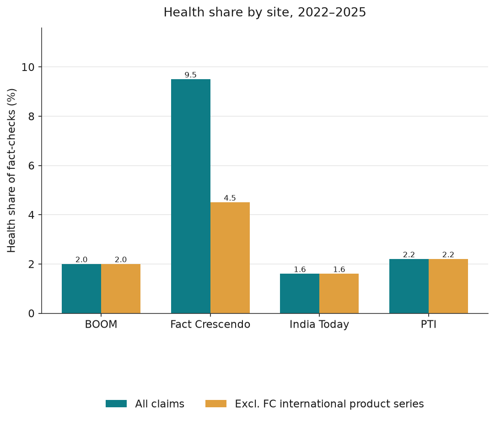

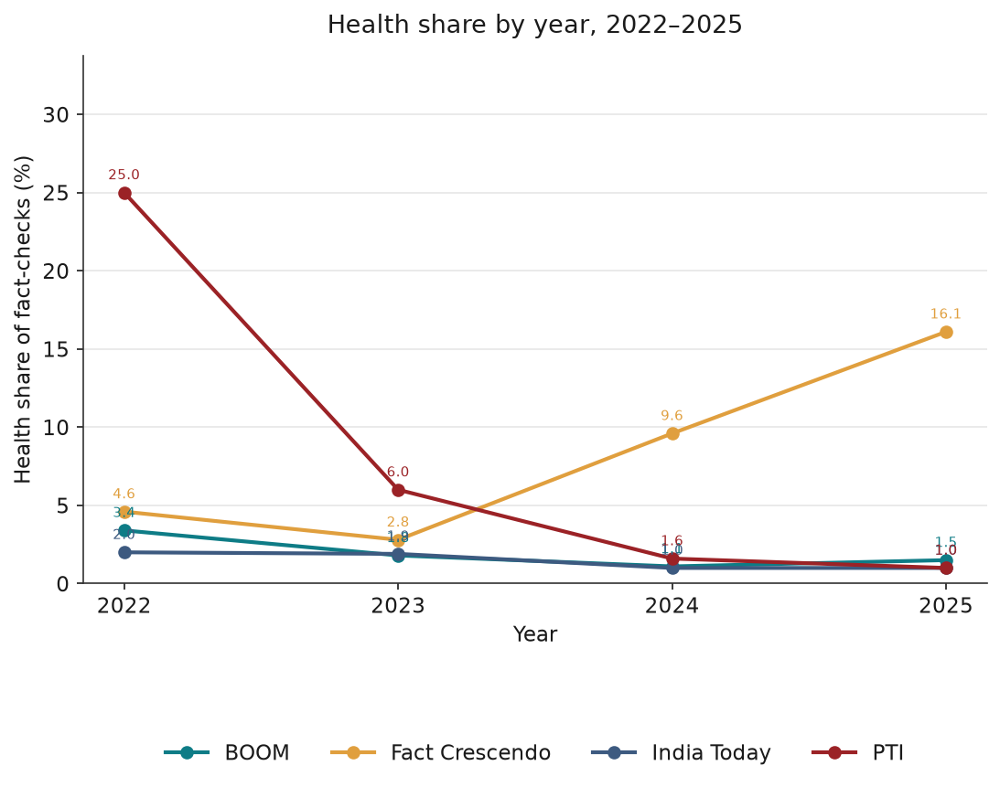

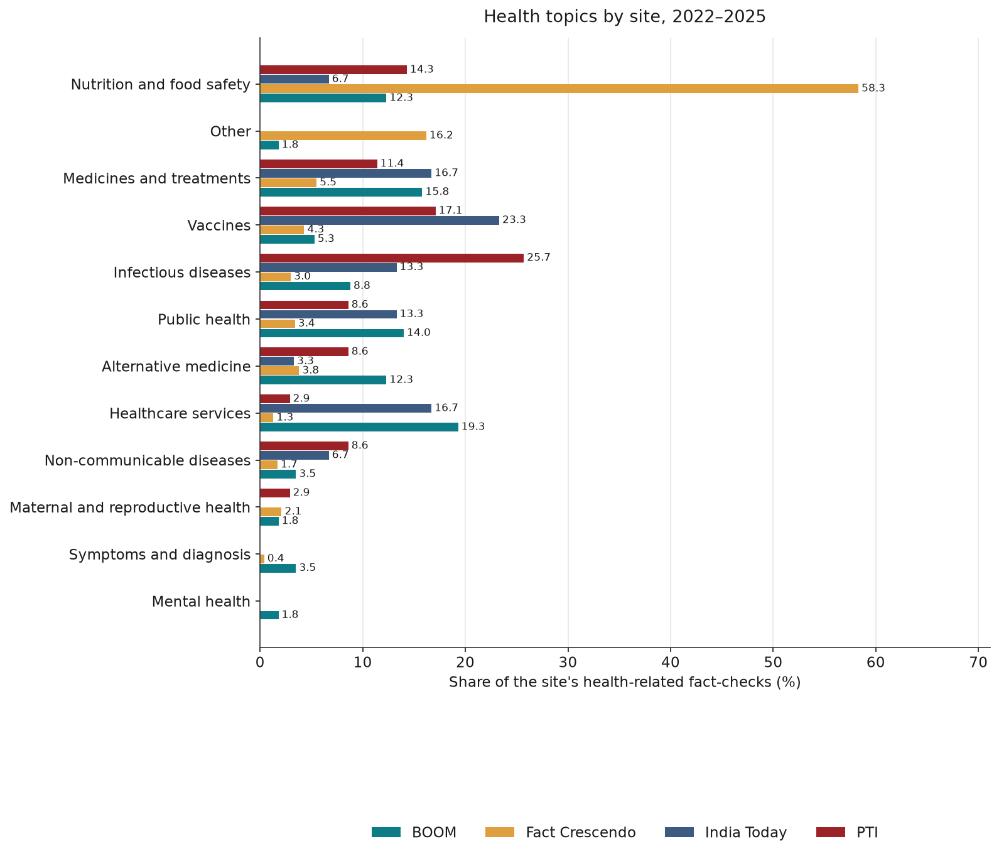

### Key findings

- Fact Crescendo has the largest health share, at 9.5% of fact-checks (235 of 2,478), of which 234 are health misinformation. Its health share after excluding its international product series is 4.5%. A manual spot-check found claim_region unreliable outside Fact Crescendo's international consumer-product series, so only that series is excluded in the adjusted view.
- Across all sites, Nutrition and food safety is the most common health topic (151 articles, 42.3% of 357 health-related fact-checks with a topic).
- Fact Crescendo has the most health-related claims coded International (160 of 235 health-related articles with a region, 68.1%).
- Health-share trends, low-n years excluded: BOOM's health share falls from 3.4% in 2022 to 1.5% in 2025; Fact Crescendo's health share rises from 4.6% in 2022 to 16.1% in 2025; India Today's health share falls from 2.0% in 2022 to 1.0% in 2025; PTI's health share falls from 6.0% in 2023 to 1.0% in 2025. PTI 2022 has only 12 fact-checks and is excluded from trend calculations.
- Excluding Fact Crescendo's international product series changes the health share most at Fact Crescendo (9.5% of all fact-checks to 4.5% after excluding that series, +5.0 percentage points). A manual spot-check found claim_region unreliable outside Fact Crescendo's international consumer-product series, so only that series is excluded in the adjusted view.

## BOOM

Source site id: `boom`.

| Year | Articles | Fact-checks | Health | Health share % | Health misinfo |
| --- | --- | --- | --- | --- | --- |
| 2022 | 832 | 830 | 28 | 3.4 | 26 |
| 2023 | 848 | 847 | 15 | 1.8 | 15 |
| 2024 | 659 | 657 | 7 | 1.1 | 7 |
| 2025 | 470 | 468 | 7 | 1.5 | 7 |
| Total | 2,809 | 2,802 | 57 | 2.0 | 55 |

Health share is health-related fact-checks divided by fact-checks.

Health topics (count and percent of health-related fact-checks):

| Topic | Count | % of health |
| --- | --- | --- |
| Healthcare services | 11 | 19.3 |
| Medicines and treatments | 9 | 15.8 |
| Public health | 8 | 14.0 |
| Alternative medicine | 7 | 12.3 |
| Nutrition and food safety | 7 | 12.3 |
| Infectious diseases | 5 | 8.8 |
| Vaccines | 3 | 5.3 |
| Non-communicable diseases | 2 | 3.5 |
| Symptoms and diagnosis | 2 | 3.5 |
| Maternal and reproductive health | 1 | 1.8 |
| Mental health | 1 | 1.8 |
| Other | 1 | 1.8 |

Normalised verdicts among health-related fact-checks:

| Verdict | Count | % of health |
| --- | --- | --- |
| False | 44 | 77.2 |
| Misleading | 11 | 19.3 |
| True | 1 | 1.8 |
| Satire | 1 | 1.8 |

AI-generated: 5 of 57 health-related rows (8.8%).
International claims: 5 of 57 health-related rows (8.8%).
Platforms named on health-related fact-checks (top 8): Facebook (31), X/Twitter (27), WhatsApp (16), Not stated (7), Social media (6), YouTube (4), News media (3), Instagram (2).
Verification methods on health-related fact-checks: Keyword search (42), Official source/statement (31), Archive/earlier version (6), Expert consultation (6), Reverse image/video search (6), Contacted original poster (4), Media forensics/AI detection (4), Government/WHO data (3).
Evidence disclosed on health-related fact-checks: Linked sources (24), Not disclosed (17), Named sources, no links (16).

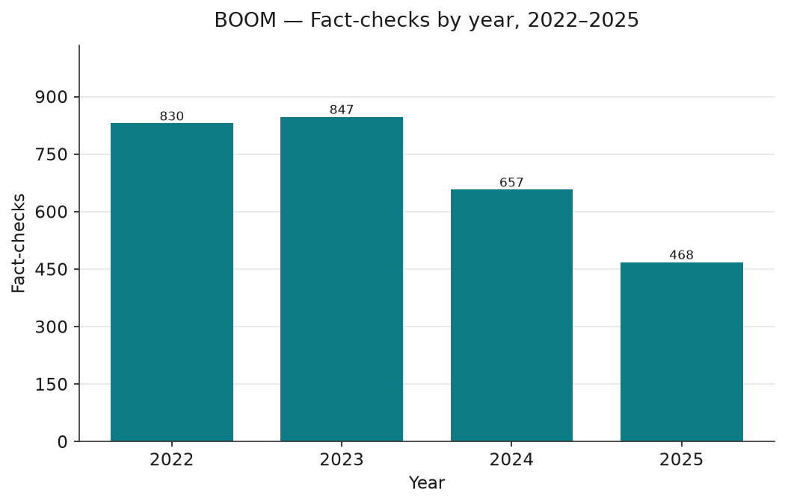

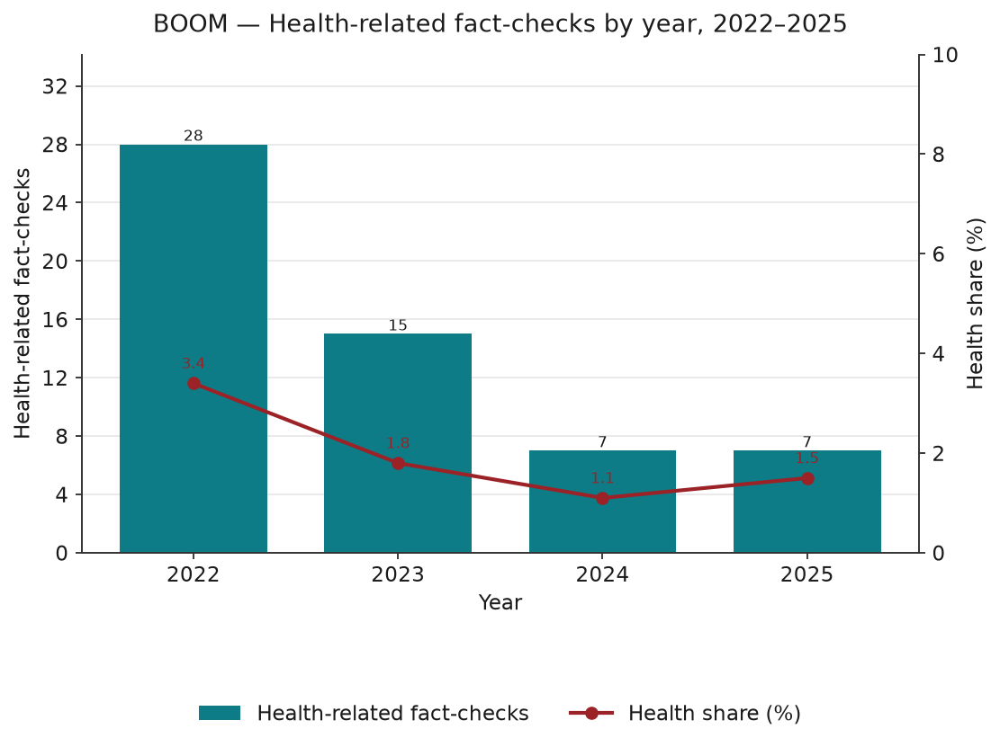

Bars are health-related fact-checks. The line is their share of all fact-checks that year.

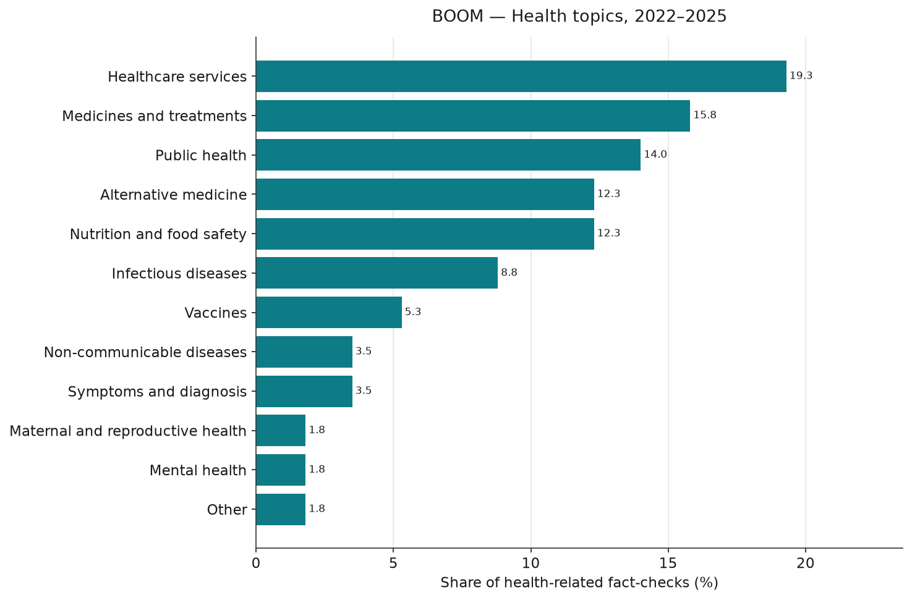

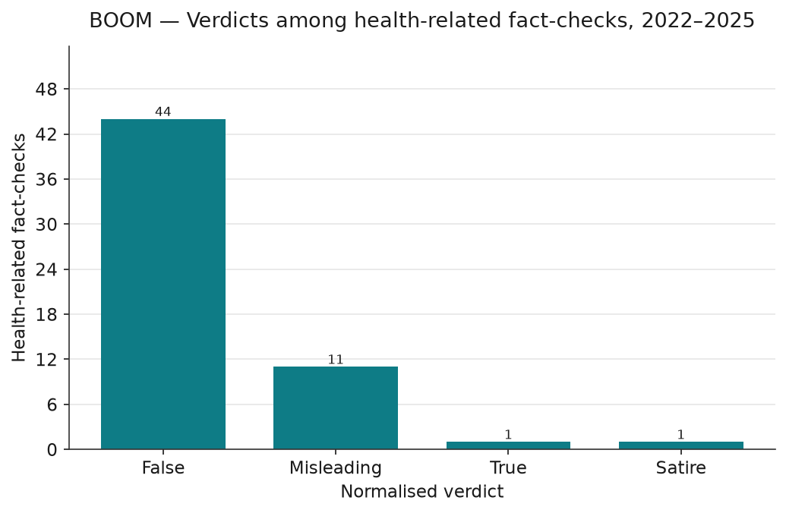

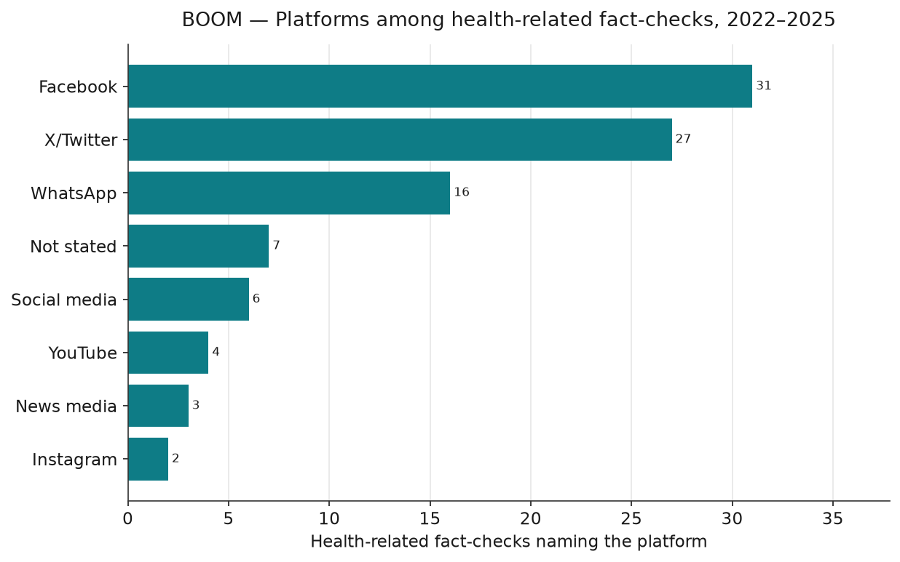

### Draft write-up

Initial LLM screening identifies 57 articles as health-related, corresponding to approximately 2.0% of BOOM's fact-checking output between 2022 and 2025 (2,802 fact-checks out of 2,809 articles). Of these, 55 meet the study definition of health misinformation (a normalised verdict of False, Misleading, or Unproven). Articles rated True (1) remain in the health count.

Healthcare services is the largest thematic category, accounting for approximately 19.3% of health-related fact-checks (11 of 57). Among health-related fact-checks, False accounts for 77.2% (44), Misleading accounts for 19.3% (11), True accounts for 1.8% (1), and Satire accounts for 1.8% (1). Approximately 8.8% are described as AI-generated (5 of 57 health-related rows with an AI flag), and claims coded International account for approximately 8.8% (5 of 57). The health share of fact-checks falls from 3.4% in 2022 to 1.5% in 2025.

## Fact Crescendo

Source site id: `factcrescendo`.

| Year | Articles | Fact-checks | Health | Health share % | Health misinfo | Fact-checks (excl. intl series) | Health (excl. intl series) | Health share % (excl. intl series) | Health misinfo (excl. intl series) |
| --- | --- | --- | --- | --- | --- | --- | --- | --- | --- |
| 2022 | 503 | 495 | 23 | 4.6 | 23 | 352 | 16 | 4.5 | 16 |
| 2023 | 492 | 460 | 13 | 2.8 | 13 | 299 | 9 | 3.0 | 9 |
| 2024 | 705 | 701 | 67 | 9.6 | 66 | 465 | 22 | 4.7 | 21 |
| 2025 | 836 | 822 | 132 | 16.1 | 132 | 560 | 28 | 5.0 | 28 |
| Total | 2,536 | 2,478 | 235 | 9.5 | 234 | 1,676 | 75 | 4.5 | 74 |

Health share is health-related fact-checks divided by fact-checks in that column's view. The adjusted columns drop this site's rows coded claim_region International. BOOM, India Today, and PTI are not given those columns, because the adjusted view keeps every one of their rows.

Health topics (count and percent of health-related fact-checks):

| Topic | Count | % of health |
| --- | --- | --- |
| Nutrition and food safety | 137 | 58.3 |
| Other | 38 | 16.2 |
| Medicines and treatments | 13 | 5.5 |
| Vaccines | 10 | 4.3 |
| Alternative medicine | 9 | 3.8 |
| Public health | 8 | 3.4 |
| Infectious diseases | 7 | 3.0 |
| Maternal and reproductive health | 5 | 2.1 |
| Non-communicable diseases | 4 | 1.7 |
| Healthcare services | 3 | 1.3 |
| Symptoms and diagnosis | 1 | 0.4 |

Normalised verdicts among health-related fact-checks:

| Verdict | Count | % of health |
| --- | --- | --- |
| False | 106 | 45.1 |
| Misleading | 128 | 54.5 |
| Not stated | 1 | 0.4 |

AI-generated: 0 of 235 health-related rows (0.0%).
International claims: 160 of 235 health-related rows (68.1%).
Platforms named on health-related fact-checks (top 8): Facebook (215), Social media (63), X/Twitter (39), Instagram (33), Other (26), WhatsApp (22), News media (10), YouTube (10).
Verification methods on health-related fact-checks: Keyword search (171), Official source/statement (162), Government/WHO data (99), Scientific literature (99), Expert consultation (39), Reverse image/video search (17), Contacted original poster (3).
Evidence disclosed on health-related fact-checks: Linked sources (178), Named sources, no links (39), Not disclosed (18).

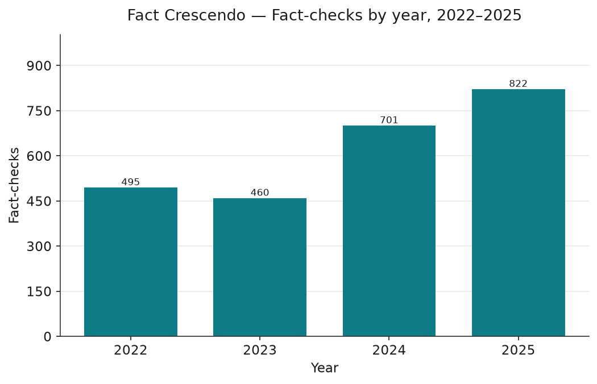

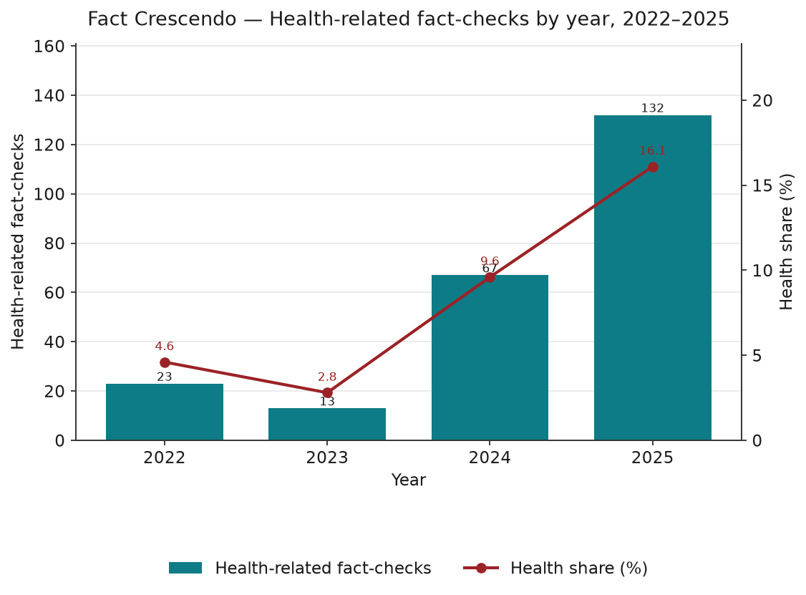

Bars are health-related fact-checks. The line is their share of all fact-checks that year.

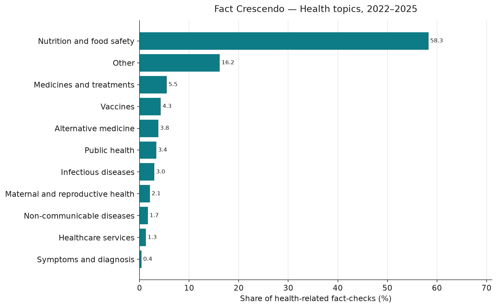

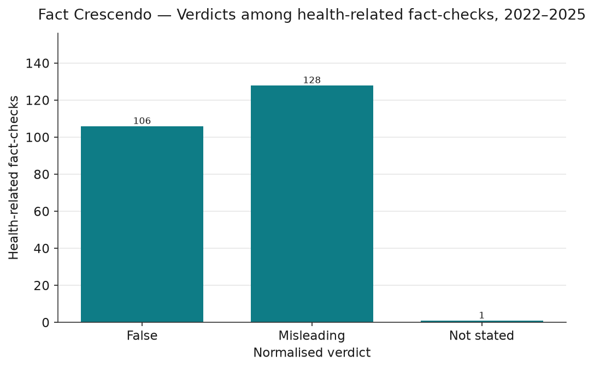

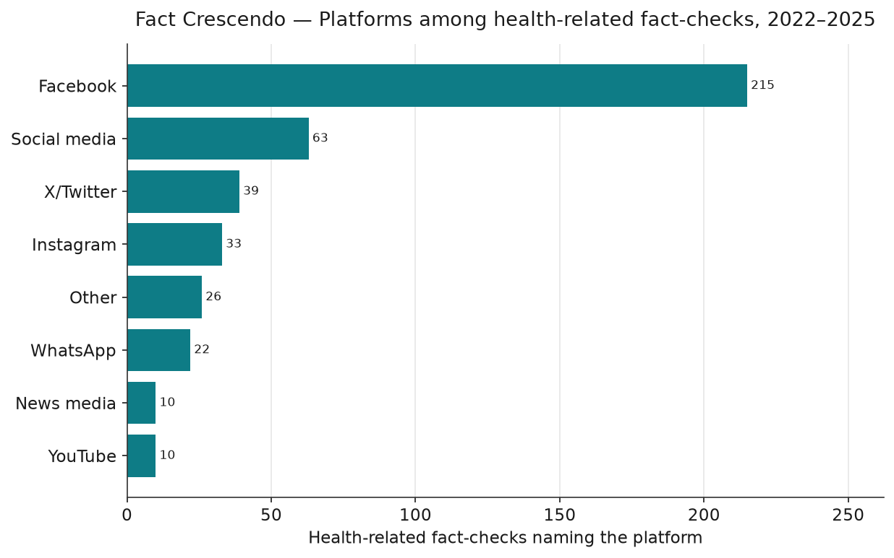

### Draft write-up

Initial LLM screening identifies 235 articles as health-related, corresponding to approximately 9.5% of Fact Crescendo's fact-checking output between 2022 and 2025 (2,478 fact-checks out of 2,536 articles). Of these, 234 meet the study definition of health misinformation (a normalised verdict of False, Misleading, or Unproven). After excluding this site's international product series (rows coded claim_region International), health-related articles number 75, or approximately 4.5% of the remaining fact-checks (1,676). 74 of them are health misinformation. A manual spot-check found claim_region unreliable outside Fact Crescendo's international consumer-product series, so only that series is excluded in the adjusted view.

Nutrition and food safety is the largest thematic category, accounting for approximately 58.3% of health-related fact-checks (137 of 235). Among health-related fact-checks, False accounts for 45.1% (106), Misleading accounts for 54.5% (128), and Not stated accounts for 0.4% (1). Approximately 0.0% are described as AI-generated (0 of 235 health-related rows with an AI flag), and claims coded International account for approximately 68.1% (160 of 235). The health share of fact-checks rises from 4.6% in 2022 to 16.1% in 2025.

## India Today

Source site id: `indiatoday`.

| Year | Articles | Fact-checks | Health | Health share % | Health misinfo |
| --- | --- | --- | --- | --- | --- |
| 2022 | 662 | 659 | 13 | 2.0 | 13 |
| 2023 | 594 | 593 | 11 | 1.9 | 11 |
| 2024 | 388 | 381 | 4 | 1.0 | 4 |
| 2025 | 218 | 209 | 2 | 1.0 | 2 |
| Total | 1,862 | 1,842 | 30 | 1.6 | 30 |

Health share is health-related fact-checks divided by fact-checks.

Health topics (count and percent of health-related fact-checks):

| Topic | Count | % of health |
| --- | --- | --- |
| Vaccines | 7 | 23.3 |
| Healthcare services | 5 | 16.7 |
| Medicines and treatments | 5 | 16.7 |
| Infectious diseases | 4 | 13.3 |
| Public health | 4 | 13.3 |
| Non-communicable diseases | 2 | 6.7 |
| Nutrition and food safety | 2 | 6.7 |
| Alternative medicine | 1 | 3.3 |

Normalised verdicts among health-related fact-checks:

| Verdict | Count | % of health |
| --- | --- | --- |
| False | 21 | 70.0 |
| Misleading | 9 | 30.0 |

AI-generated: 2 of 30 health-related rows (6.7%).
International claims: 15 of 30 health-related rows (50.0%).
Platforms named on health-related fact-checks (top 8): X/Twitter (19), Facebook (12), YouTube (5), Social media (4), News media (3), Instagram (2), Other (1).
Verification methods on health-related fact-checks: Keyword search (27), Official source/statement (15), Reverse image/video search (15), Expert consultation (6), Archive/earlier version (2), Government/WHO data (1), Scientific literature (1).
Evidence disclosed on health-related fact-checks: Linked sources (12), Named sources, no links (12), Not disclosed (6).

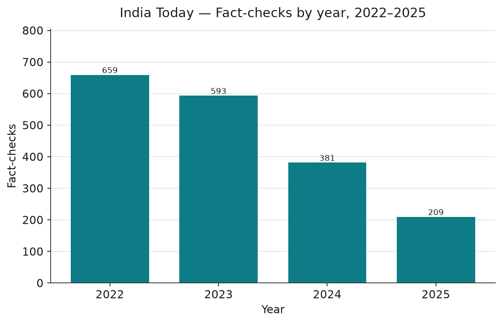

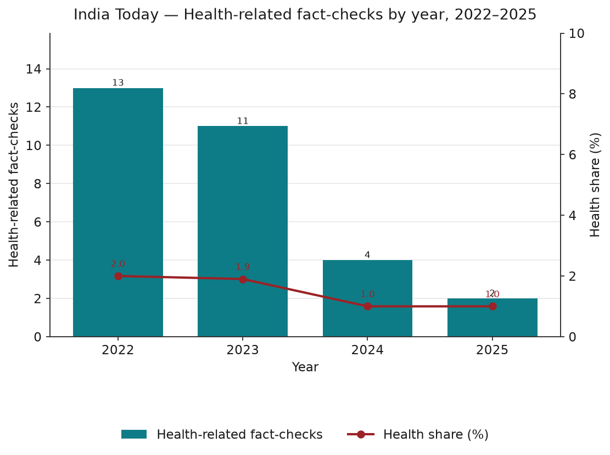

Bars are health-related fact-checks. The line is their share of all fact-checks that year.

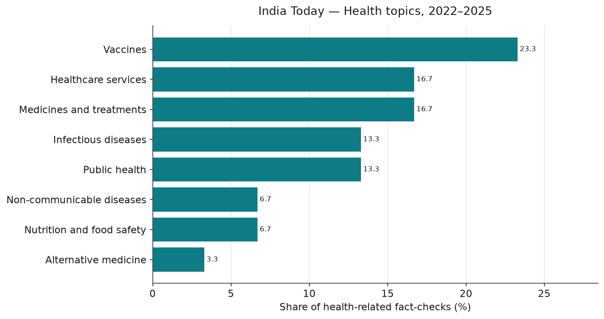

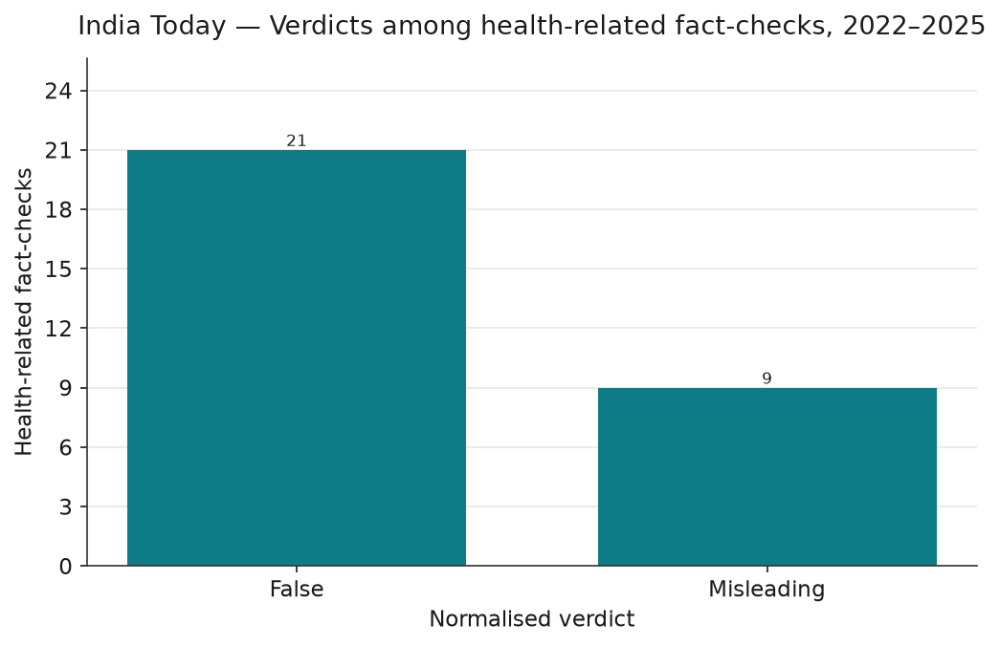

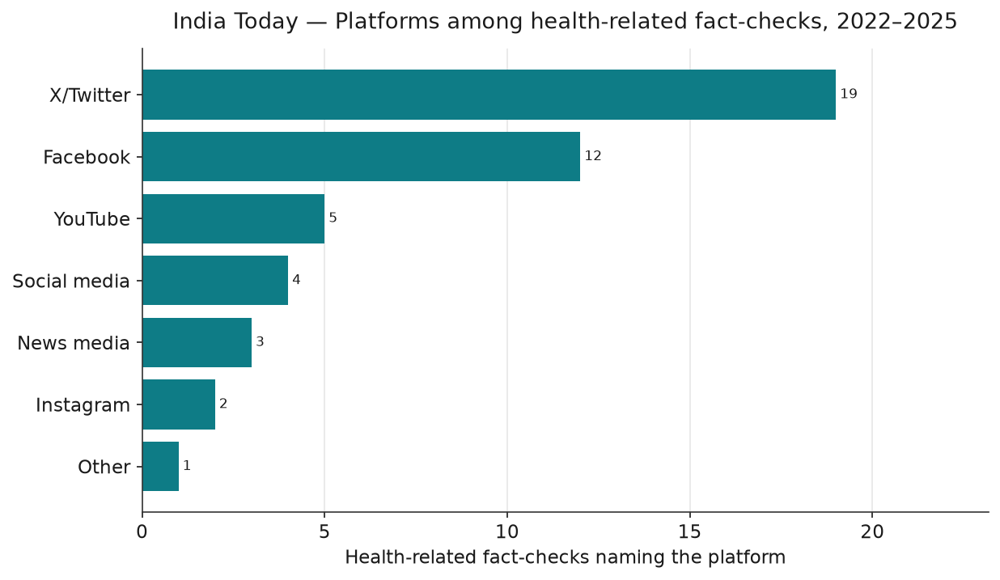

### Draft write-up

Initial LLM screening identifies 30 articles as health-related, corresponding to approximately 1.6% of India Today's fact-checking output between 2022 and 2025 (1,842 fact-checks out of 1,862 articles). Of these, 30 meet the study definition of health misinformation (a normalised verdict of False, Misleading, or Unproven).

Vaccines is the largest thematic category, accounting for 23.3%, 7 of 30 health-related fact-checks. Among health-related fact-checks, False accounts for 70.0%, 21 of 30 and Misleading accounts for 30.0%, 9 of 30. AI-generated claims account for 6.7%, 2 of 30, and claims coded International account for 50.0%, 15 of 30. The health share of fact-checks falls from 2.0% in 2022 to 1.0% in 2025. Small base.

## PTI

Source site id: `pti`.

| Year | Articles | Fact-checks | Health | Health share % | Health misinfo |
| --- | --- | --- | --- | --- | --- |
| 2022 (low n) | 12 | 12 | 3 | 25.0 | 3 |
| 2023 | 283 | 283 | 17 | 6.0 | 17 |
| 2024 | 387 | 386 | 6 | 1.6 | 6 |
| 2025 | 878 | 875 | 9 | 1.0 | 9 |
| Total | 1,560 | 1,556 | 35 | 2.2 | 35 |

Health share is health-related fact-checks divided by fact-checks.

Health topics (count and percent of health-related fact-checks):

| Topic | Count | % of health |
| --- | --- | --- |
| Infectious diseases | 9 | 25.7 |
| Vaccines | 6 | 17.1 |
| Nutrition and food safety | 5 | 14.3 |
| Medicines and treatments | 4 | 11.4 |
| Alternative medicine | 3 | 8.6 |
| Non-communicable diseases | 3 | 8.6 |
| Public health | 3 | 8.6 |
| Healthcare services | 1 | 2.9 |
| Maternal and reproductive health | 1 | 2.9 |

Normalised verdicts among health-related fact-checks:

| Verdict | Count | % of health |
| --- | --- | --- |
| False | 25 | 71.4 |
| Misleading | 10 | 28.6 |

AI-generated: 7 of 35 health-related rows (20.0%).
International claims: 9 of 35 health-related rows (25.7%).
Platforms named on health-related fact-checks (top 8): X/Twitter (20), Facebook (16), Social media (10), WhatsApp (5), YouTube (5), Instagram (4), Other (3), News media (1).
Verification methods on health-related fact-checks: Keyword search (28), Reverse image/video search (23), Official source/statement (15), Expert consultation (9), Government/WHO data (6), Media forensics/AI detection (6), Scientific literature (4), Archive/earlier version (2).
Evidence disclosed on health-related fact-checks: Linked sources (26), Named sources, no links (7), Not disclosed (2).

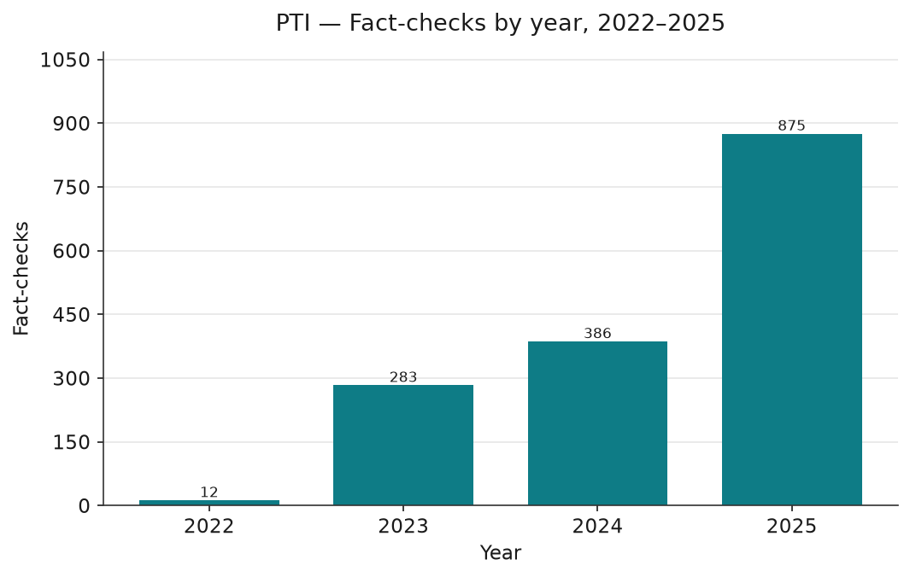

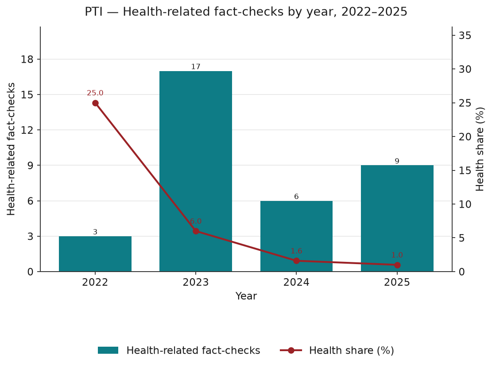

Bars are health-related fact-checks. The line is their share of all fact-checks that year.

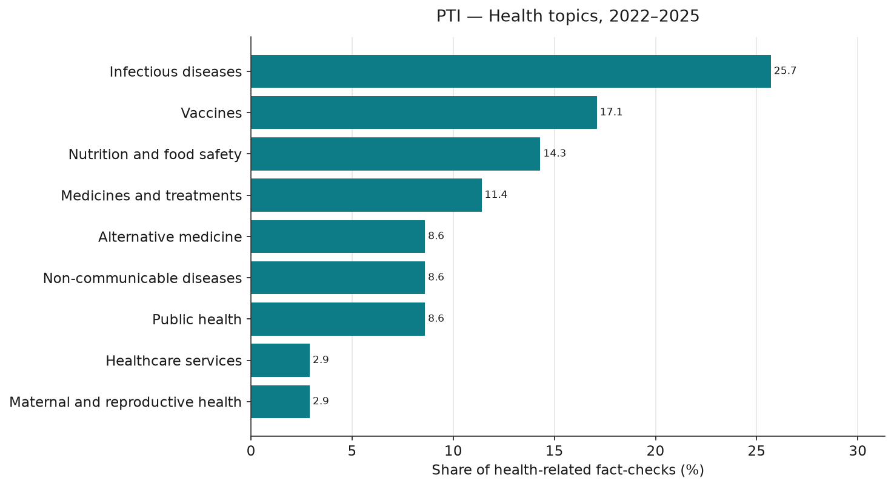

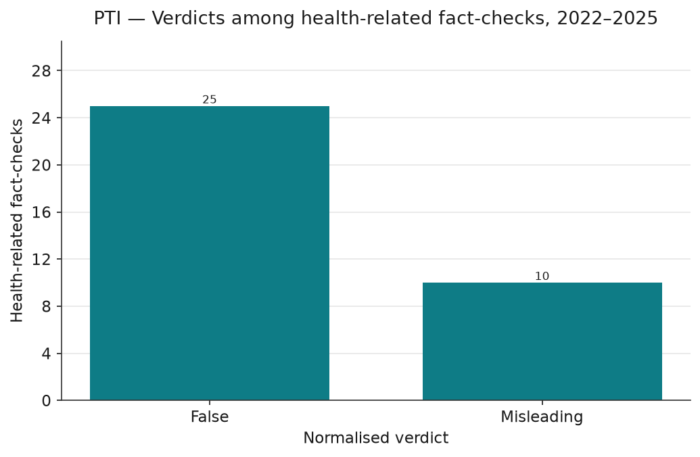

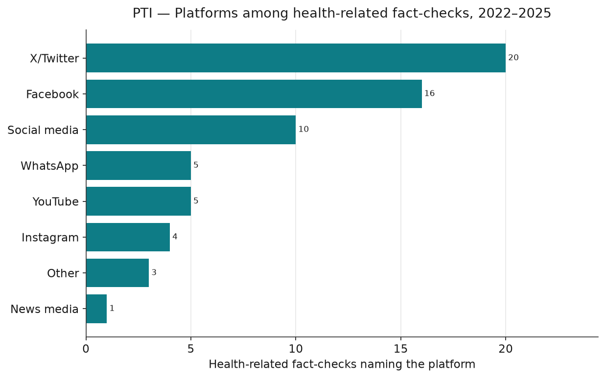

### Draft write-up

Initial LLM screening identifies 35 articles as health-related, corresponding to approximately 2.2% of PTI's fact-checking output between 2022 and 2025 (1,556 fact-checks out of 1,560 articles). Of these, 35 meet the study definition of health misinformation (a normalised verdict of False, Misleading, or Unproven).

Infectious diseases is the largest thematic category, accounting for 25.7%, 9 of 35 health-related fact-checks. Among health-related fact-checks, False accounts for 71.4%, 25 of 35 and Misleading accounts for 28.6%, 10 of 35. AI-generated claims account for 20.0%, 7 of 35, and claims coded International account for 25.7%, 9 of 35. The health share of fact-checks falls from 6.0% in 2023 to 1.0% in 2025. PTI 2022 has only 12 fact-checks and is excluded from trend calculations. Small base.

## Deeper findings

Tables: `health_vs_nonhealth.csv`, `topics_by_year.csv`, `platform_by_topic.csv`, `ai_trend.csv`. Each table has a `view` column for all claims, the pool excluding Fact Crescendo's international product series, and the pool with Fact Crescendo removed.

Health and non-health percentages use fact-checks as the base. A fact-check with `health_related` true is health-related; one with `health_related` false is another fact-check. Unrecognised `health_related` values are in neither group. Topic shares are the percentage of that year's health-related fact-checks; a topic with no articles in a year that does have health-related fact-checks is 0% for the change calculation. A topic-share change smaller than 1 percentage point is described as roughly flat. Platform counts allow an article to contribute to more than one platform. AI shares are the percentage of each group flagged `ai_generated_misinfo`. The charts use the view that excludes Fact Crescendo's international product series. The bullets state the same finding in all three views.

- Health versus non-health. All claims, all sites (health-related n=357; other fact-checks n=8,321): A False verdict is 54.9% of health-related fact-checks and 70.9% of other fact-checks. A Misleading verdict is 44.3% of health-related fact-checks and 28.7% of other fact-checks. An AI-generated flag is 3.9% of health-related fact-checks and 6.9% of other fact-checks. Expert consultation is 16.8% of health-related fact-checks and 4.4% of other fact-checks. Scientific literature is 29.7% of health-related fact-checks and 0.1% of other fact-checks. Linked sources is 67.2% of health-related fact-checks and 58.4% of other fact-checks. 235 of 357 health-related fact-checks are from Fact Crescendo. Excl. FC international product series (health-related n=197; other fact-checks n=7,679): A False verdict is 65.5% of health-related fact-checks and 71.6% of other fact-checks. A Misleading verdict is 33.0% of health-related fact-checks and 28.0% of other fact-checks. An AI-generated flag is 7.1% of health-related fact-checks and 7.2% of other fact-checks. Expert consultation is 18.3% of health-related fact-checks and 4.6% of other fact-checks. Scientific literature is 14.7% of health-related fact-checks and 0.0% of other fact-checks. Linked sources is 60.4% of health-related fact-checks and 56.9% of other fact-checks. 75 of 197 health-related fact-checks are from Fact Crescendo. Excluding Fact Crescendo (health-related n=122; other fact-checks n=6,078): A False verdict is 73.8% of health-related fact-checks and 74.4% of other fact-checks. A Misleading verdict is 24.6% of health-related fact-checks and 25.2% of other fact-checks. An AI-generated flag is 11.5% of health-related fact-checks and 8.6% of other fact-checks. Expert consultation is 17.2% of health-related fact-checks and 5.2% of other fact-checks. Scientific literature is 5.7% of health-related fact-checks and 0.0% of other fact-checks. Linked sources is 50.8% of health-related fact-checks and 52.9% of other fact-checks. 57 of 122 health-related fact-checks are from BOOM. This health versus non-health contrast does not hold across views: it changes when Fact Crescendo is excluded, so it is driven by Fact Crescendo; it changes when Fact Crescendo's international product series is excluded, so that series affects it.
- Topic mix over time. All claims, all sites: in 2022 the leading health topic is Vaccines (17.9% of 67); in 2025 it is Nutrition and food safety (58.0% of 150). The largest rise is Nutrition and food safety from 10.4% to 58.0% (+47.6 percentage points). The largest fall is Vaccines from 17.9% to 2.0% (-15.9 percentage points). 235 of 357 health-related fact-checks with a topic are from Fact Crescendo; in 2022, 28 of 67 health-related fact-checks with a topic are from BOOM; in 2025, 132 of 150 health-related fact-checks with a topic are from Fact Crescendo. Excl. FC international product series: in 2022 the leading health topic is Public health (18.3% of 60); in 2025 it is Nutrition and food safety (41.3% of 46). The largest rise is Nutrition and food safety from 11.7% to 41.3% (+29.6 percentage points). The largest fall is Vaccines from 13.3% to 2.2% (-11.1 percentage points). 75 of 197 health-related fact-checks with a topic are from Fact Crescendo; in 2022, 28 of 60 health-related fact-checks with a topic are from BOOM; in 2025, 28 of 46 health-related fact-checks with a topic are from Fact Crescendo. Excluding Fact Crescendo: in 2022 the leading health topic is Public health (18.2% of 44); in 2025 it is Public health (22.2% of 18). The largest rise is Maternal and reproductive health from 0.0% to 5.6% and Mental health from 0.0% to 5.6% (+5.6 percentage points). The largest fall is Vaccines from 13.6% to 0.0% (-13.6 percentage points). 57 of 122 health-related fact-checks with a topic are from BOOM; in 2022, 28 of 44 health-related fact-checks with a topic are from BOOM; in 2025, 9 of 18 health-related fact-checks with a topic are from PTI. This topic-mix finding does not hold across views: it changes when Fact Crescendo is excluded, so it is driven by Fact Crescendo; it changes when Fact Crescendo's international product series is excluded, so that series affects it.
- Platforms by topic. All claims, all sites: the most named platform is Facebook (76.8% of 357 articles). The largest cell is Nutrition and food safety × Facebook (142). 235 of 357 health-related fact-checks with a topic and a platform are from Fact Crescendo. Excl. FC international product series: the most named platform is Facebook (62.4% of 197 articles). The largest cell is Nutrition and food safety × Facebook (44). 75 of 197 health-related fact-checks with a topic and a platform are from Fact Crescendo. Excluding Fact Crescendo: the most named platform is X/Twitter (54.1% of 122 articles). The largest cell is Medicines and treatments × Facebook and Vaccines × X/Twitter (each 15). 57 of 122 health-related fact-checks with a topic and a platform are from BOOM. This platform finding does not hold across views: it changes when Fact Crescendo is excluded, so it is driven by Fact Crescendo.
- AI-generated trend. All claims, all sites: The health-related AI-generated share rises from 0.0% in 2022 to 1.3% in 2025. The other-fact-check AI-generated share rises from 0.2% in 2022 to 17.0% in 2025. 235 of 357 health-related fact-checks with an AI flag are from Fact Crescendo; 132 of 150 health-related fact-checks with an AI flag in 2025 are from Fact Crescendo. Excl. FC international product series: The health-related AI-generated share rises from 0.0% in 2022 to 4.3%, 2 of 46 in 2025. The other-fact-check AI-generated share rises from 0.1% in 2022 to 17.7% in 2025. 75 of 197 health-related fact-checks with an AI flag are from Fact Crescendo; 28 of 46 health-related fact-checks with an AI flag in 2025 are from Fact Crescendo. Excluding Fact Crescendo: The health-related AI-generated share rises from 0.0%, 0 of 44 in 2022 to 11.1%, 2 of 18 in 2025. The other-fact-check AI-generated share rises from 0.1% in 2022 to 22.7% in 2025. 57 of 122 health-related fact-checks with an AI flag are from BOOM; 9 of 18 health-related fact-checks with an AI flag in 2025 are from PTI. This AI-generated trend holds across all three views.

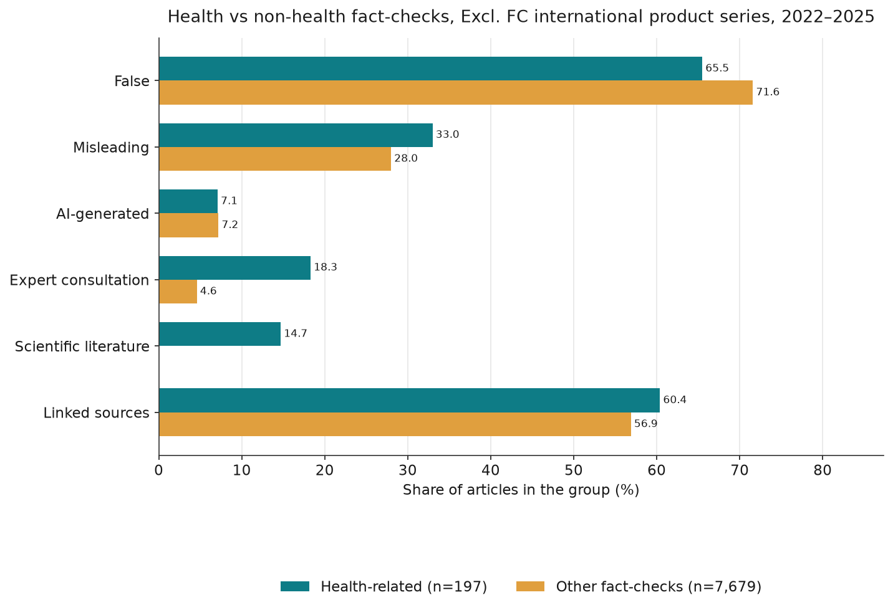

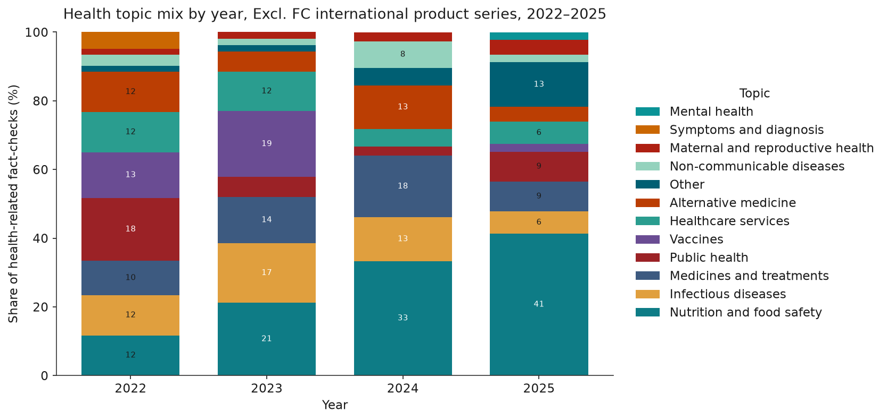

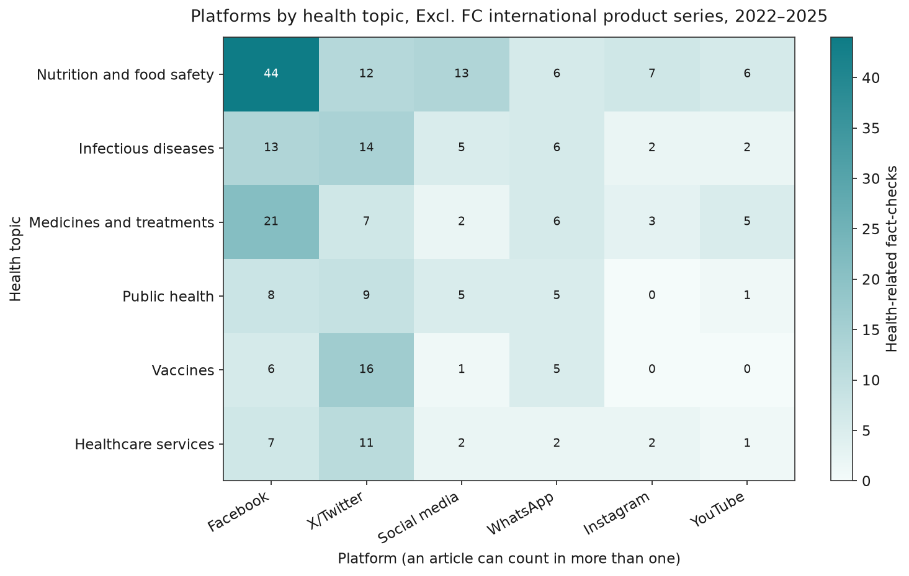

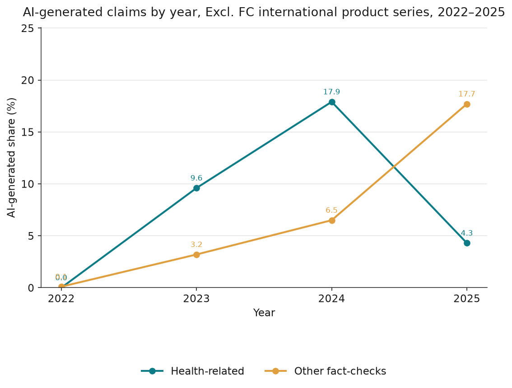

## Data notes

Year is the four-digit token in `_full_<year>_`. Article dates are parsed with `format="mixed"`, `dayfirst=True`, and `errors="coerce"`, and are used only to count disagreements with the filename year. A date whose calendar year differs from the filename is counted under "Date year differs". A date that could not be parsed is counted under "Date unparsed" and is not also counted as a disagreement.

| File | Year | Rows | Fact-checks in 2022–2025 | Date year differs | Date unparsed | Missing columns |
| --- | --- | --- | --- | --- | --- | --- |
| boom_full_2022_classified.csv | 2022 | 832 | 830 | 0 | 0 | — |
| boom_full_2023_classified.csv | 2023 | 848 | 847 | 0 | 0 | — |
| boom_full_2024_classified.csv | 2024 | 659 | 657 | 0 | 0 | — |
| boom_full_2025_classified.csv | 2025 | 470 | 468 | 0 | 0 | — |
| factcrescendo_full_2022_classified.csv | 2022 | 503 | 495 | 0 | 0 | — |
| factcrescendo_full_2023_classified.csv | 2023 | 492 | 460 | 0 | 0 | — |
| factcrescendo_full_2024_classified.csv | 2024 | 705 | 701 | 0 | 0 | — |
| factcrescendo_full_2025_classified.csv | 2025 | 836 | 822 | 0 | 0 | — |
| indiatoday_full_2022_classified.csv | 2022 | 662 | 659 | 0 | 0 | — |
| indiatoday_full_2023_classified.csv | 2023 | 594 | 593 | 0 | 0 | — |
| indiatoday_full_2024_classified.csv | 2024 | 388 | 381 | 0 | 0 | — |
| indiatoday_full_2025_classified.csv | 2025 | 218 | 209 | 0 | 0 | — |
| pti_full_2022_classified.csv | 2022 | 12 | 12 | 0 | 0 | — |
| pti_full_2023_classified.csv | 2023 | 283 | 283 | 0 | 0 | — |
| pti_full_2024_classified.csv | 2024 | 387 | 386 | 0 | 0 | — |
| pti_full_2025_classified.csv | 2025 | 878 | 875 | 0 | 0 | — |

`possible_duplicate_title` is present on 4 file(s) and flags 6 rows. Flagged rows are kept in every total.
Observed prompt_version values: v3 8,767.
Low n (fewer than 100 fact-checks; excluded from trend calculations): PTI 2022 (12 fact-checks).

Labels for `is_fact_check`, `health_related`, `health_topic`, `rating_normalized`, `platforms`, `verification_methods`, `evidence_disclosed`, `ai_generated_misinfo`, and `claim_region` are LLM-generated (prompt v3) and are pending manual validation. Figures in this report are preliminary.

### Manual corrections

- `pti`: `health_related` set to No. `health_topic` was also set to "Not health-related". Matched title: "PTI Fact Check: False claim about US President Donald Trump being in coma circulates online; details inside". Reason: Politician illness hoax excluded by protocol.
- `pti`: `health_related` set to No. `health_topic` was also set to "Not health-related". Matched title: "PTI Fact Check: AI-generated photo falsely shared claiming Elon Musk asked good wishes for his daughter 'who recovered from cancer'". Reason: Celebrity illness hoax excluded by protocol.
- `indiatoday`: `health_related` set to No. `health_topic` was also set to "Not health-related". Matched title: "Fact Check: AI-generated images shared as Putin collapsing after suffering heart attack". Reason: Politician illness hoax excluded by protocol.
- `indiatoday`: `health_related` set to No. `health_topic` was also set to "Not health-related". Matched title: "Fact Check: Brazilian bike rally video makes its way into clip of Germans riding for cancer patient". Reason: Primary claim concerns video location not health.

4 LLM labels corrected after manual review.
